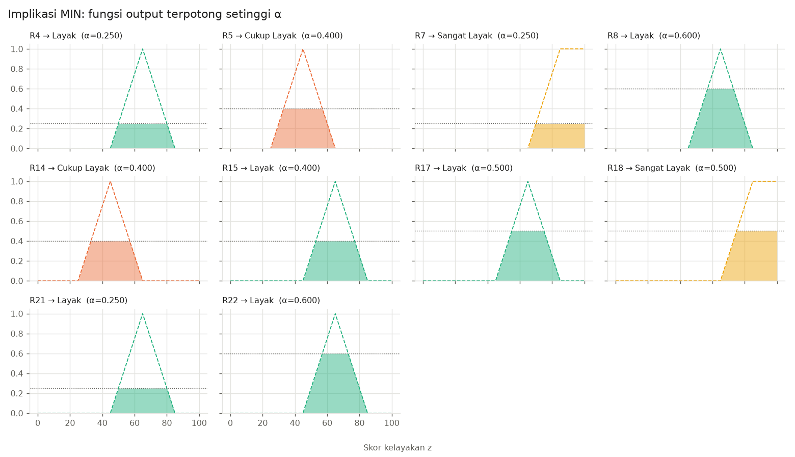
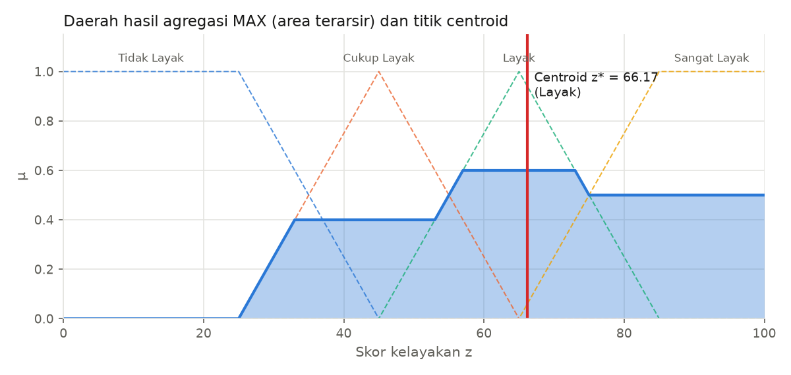

### Data mahasiswa

| Variabel | Nilai |
|---|---|
| IPK | 3.3  |
| Penghasilan Orang Tua | 3.5 juta Rp/bulan |
| Jumlah Tanggungan Keluarga | 4 orang |
| Skor Prestasi | 62 skor |

### Langkah 1 — Fuzzifikasi

| Variabel | Kategori | Parameter | Substitusi | μ |
|---|---|---|---|---|
| IPK | Rendah | trap(0, 0, 2.5, 3) | x ≤ 0 atau x ≥ 3 → μ = 0 | **0.0000** |
| IPK | Sedang | tri(2.5, 3, 3.5) | (d − x)/(d − c) = (3.5 − 3.3) / (3.5 − 3) = 0.4000 | **0.4000** |
| IPK | Tinggi | trap(3, 3.5, 4, 4) | (x − a)/(b − a) = (3.3 − 3) / (3.5 − 3) = 0.6000 | **0.6000** |
| Penghasilan Orang Tua | Rendah | trap(0, 0, 2, 4) | (d − x)/(d − c) = (4 − 3.5) / (4 − 2) = 0.2500 | **0.2500** |
| Penghasilan Orang Tua | Sedang | trap(2, 4, 6, 9) | (x − a)/(b − a) = (3.5 − 2) / (4 − 2) = 0.7500 | **0.7500** |
| Penghasilan Orang Tua | Tinggi | trap(6, 9, 15, 15) | x ≤ 6 atau x ≥ 15 → μ = 0 | **0.0000** |
| Jumlah Tanggungan Keluarga | Sedikit | trap(0, 0, 1, 3) | x ≤ 0 atau x ≥ 3 → μ = 0 | **0.0000** |
| Jumlah Tanggungan Keluarga | Sedang | tri(1, 3, 5) | (d − x)/(d − c) = (5 − 4) / (5 − 3) = 0.5000 | **0.5000** |
| Jumlah Tanggungan Keluarga | Banyak | trap(3, 5, 8, 8) | (x − a)/(b − a) = (4 − 3) / (5 − 3) = 0.5000 | **0.5000** |
| Skor Prestasi | Rendah | trap(0, 0, 30, 50) | x ≤ 0 atau x ≥ 50 → μ = 0 | **0.0000** |
| Skor Prestasi | Sedang | tri(30, 50, 70) | (d − x)/(d − c) = (70 − 62) / (70 − 50) = 0.4000 | **0.4000** |
| Skor Prestasi | Tinggi | trap(50, 70, 100, 100) | (x − a)/(b − a) = (62 − 50) / (70 − 50) = 0.6000 | **0.6000** |

### Langkah 2 — α-predikat setiap aturan (AND = MIN)

| Aturan | Anteseden | MIN(...) | α | Konsekuen |
|---|---|---|---|---|
| R1 | IPK Rendah ∧ Penghasilan Orang Tua Rendah | MIN(0.0000, 0.2500) | 0 | Cukup Layak |
| R2 | IPK Rendah ∧ Penghasilan Orang Tua Sedang | MIN(0.0000, 0.7500) | 0 | Tidak Layak |
| R3 | IPK Rendah ∧ Penghasilan Orang Tua Tinggi | MIN(0.0000, 0.0000) | 0 | Tidak Layak |
| R4 | IPK Sedang ∧ Penghasilan Orang Tua Rendah | MIN(0.4000, 0.2500) | **0.2500** | Layak |
| R5 | IPK Sedang ∧ Penghasilan Orang Tua Sedang | MIN(0.4000, 0.7500) | **0.4000** | Cukup Layak |
| R6 | IPK Sedang ∧ Penghasilan Orang Tua Tinggi | MIN(0.4000, 0.0000) | 0 | Tidak Layak |
| R7 | IPK Tinggi ∧ Penghasilan Orang Tua Rendah | MIN(0.6000, 0.2500) | **0.2500** | Sangat Layak |
| R8 | IPK Tinggi ∧ Penghasilan Orang Tua Sedang | MIN(0.6000, 0.7500) | **0.6000** | Layak |
| R9 | IPK Tinggi ∧ Penghasilan Orang Tua Tinggi | MIN(0.6000, 0.0000) | 0 | Cukup Layak |
| R10 | Skor Prestasi Rendah ∧ Jumlah Tanggungan Keluarga Sedikit | MIN(0.0000, 0.0000) | 0 | Tidak Layak |
| R11 | Skor Prestasi Rendah ∧ Jumlah Tanggungan Keluarga Sedang | MIN(0.0000, 0.5000) | 0 | Tidak Layak |
| R12 | Skor Prestasi Rendah ∧ Jumlah Tanggungan Keluarga Banyak | MIN(0.0000, 0.5000) | 0 | Cukup Layak |
| R13 | Skor Prestasi Sedang ∧ Jumlah Tanggungan Keluarga Sedikit | MIN(0.4000, 0.0000) | 0 | Tidak Layak |
| R14 | Skor Prestasi Sedang ∧ Jumlah Tanggungan Keluarga Sedang | MIN(0.4000, 0.5000) | **0.4000** | Cukup Layak |
| R15 | Skor Prestasi Sedang ∧ Jumlah Tanggungan Keluarga Banyak | MIN(0.4000, 0.5000) | **0.4000** | Layak |
| R16 | Skor Prestasi Tinggi ∧ Jumlah Tanggungan Keluarga Sedikit | MIN(0.6000, 0.0000) | 0 | Cukup Layak |
| R17 | Skor Prestasi Tinggi ∧ Jumlah Tanggungan Keluarga Sedang | MIN(0.6000, 0.5000) | **0.5000** | Layak |
| R18 | Skor Prestasi Tinggi ∧ Jumlah Tanggungan Keluarga Banyak | MIN(0.6000, 0.5000) | **0.5000** | Sangat Layak |
| R19 | IPK Rendah ∧ Skor Prestasi Rendah | MIN(0.0000, 0.0000) | 0 | Tidak Layak |
| R20 | Penghasilan Orang Tua Tinggi ∧ Jumlah Tanggungan Keluarga Sedikit | MIN(0.0000, 0.0000) | 0 | Tidak Layak |
| R21 | Penghasilan Orang Tua Rendah ∧ Jumlah Tanggungan Keluarga Banyak | MIN(0.2500, 0.5000) | **0.2500** | Layak |
| R22 | IPK Tinggi ∧ Skor Prestasi Tinggi | MIN(0.6000, 0.6000) | **0.6000** | Layak |

Aturan aktif (α > 0): **10** dari 22 — R4, R5, R7, R8, R14, R15, R17, R18, R21, R22.

### Langkah 3 — Implikasi MIN (clipping)

Untuk setiap aturan aktif i: μ_i(z) = min(α_i, μ_konsekuen(z)). Jika beberapa aturan memiliki konsekuen sama, yang menentukan bentuk akhir adalah α terbesar:

| Kategori output | Aturan aktif | α terbesar (tinggi potongan) |
|---|---|---|
| Tidak Layak | – | 0 |
| Cukup Layak | R5 (0.4000), R14 (0.4000) | **0.4000** |
| Layak | R4 (0.2500), R8 (0.6000), R15 (0.4000), R17 (0.5000), R21 (0.2500), R22 (0.6000) | **0.6000** |
| Sangat Layak | R7 (0.2500), R18 (0.5000) | **0.5000** |

### Langkah 4 — Agregasi MAX

μ_agr(z) = max_i μ_i(z) = max over kategori k dari min(α_k, μ_k(z)), dengan α_k = tinggi potongan pada tabel di atas.

Contoh nilai μ_agr pada beberapa titik z:

| z | min(α, μ_Tidak Layak) | min(α, μ_Cukup Layak) | min(α, μ_Layak) | min(α, μ_Sangat Layak) | μ_agr(z) |
|---|---|---|---|---|---|
| 0 | 0.0000 | 0.0000 | 0.0000 | 0.0000 | **0.0000** |
| 10 | 0.0000 | 0.0000 | 0.0000 | 0.0000 | **0.0000** |
| 20 | 0.0000 | 0.0000 | 0.0000 | 0.0000 | **0.0000** |
| 30 | 0.0000 | 0.2500 | 0.0000 | 0.0000 | **0.2500** |
| 35 | 0.0000 | 0.4000 | 0.0000 | 0.0000 | **0.4000** |
| 40 | 0.0000 | 0.4000 | 0.0000 | 0.0000 | **0.4000** |
| 45 | 0.0000 | 0.4000 | 0.0000 | 0.0000 | **0.4000** |
| 50 | 0.0000 | 0.4000 | 0.2500 | 0.0000 | **0.4000** |
| 55 | 0.0000 | 0.4000 | 0.5000 | 0.0000 | **0.5000** |
| 60 | 0.0000 | 0.2500 | 0.6000 | 0.0000 | **0.6000** |
| 65 | 0.0000 | 0.0000 | 0.6000 | 0.0000 | **0.6000** |
| 70 | 0.0000 | 0.0000 | 0.6000 | 0.2500 | **0.6000** |
| 75 | 0.0000 | 0.0000 | 0.5000 | 0.5000 | **0.5000** |
| 80 | 0.0000 | 0.0000 | 0.2500 | 0.5000 | **0.5000** |
| 85 | 0.0000 | 0.0000 | 0.0000 | 0.5000 | **0.5000** |
| 90 | 0.0000 | 0.0000 | 0.0000 | 0.5000 | **0.5000** |
| 100 | 0.0000 | 0.0000 | 0.0000 | 0.5000 | **0.5000** |

### Langkah 5 — Defuzzifikasi centroid (diskrit)

Grid output: z = 0, 0.1, 0.2, …, 100 (langkah Δz = 0.1, **1001 titik**).

$$z^* = \frac{\sum_{i} \mu_{agr}(z_i)\, z_i}{\sum_{i} \mu_{agr}(z_i)} = \frac{23044.1750}{348.2500} = 66.1714$$

**Skor kelayakan = 66.17 → kategori _Layak_** (rekomendasi, bukan keputusan final).