# Pengembangan Sistem Pendukung Keputusan Kelayakan Penerima Beasiswa Menggunakan Logika Fuzzy Metode Mamdani

Laporan Tugas Projek Mata Kuliah Logika Fuzzy

---

## 1. Identifikasi Masalah

Seleksi penerima beasiswa umumnya menilai dua hal sekaligus: **merit akademik** (IPK, prestasi) dan **kebutuhan ekonomi** (penghasilan orang tua, jumlah tanggungan). Penilaian dengan ambang tegas (misalnya "IPK ≥ 3,00 lolos, < 3,00 gugur") menimbulkan ketidakadilan di sekitar batas: mahasiswa dengan IPK 2,99 diperlakukan sama dengan IPK 2,00. Selain itu kriteria sering saling bertentangan, misalnya IPK tinggi tetapi keluarga mampu. Logika fuzzy cocok untuk masalah ini karena setiap kriteria dinilai secara bertingkat (derajat keanggotaan 0–1) dan pengetahuan panitia dapat dituliskan sebagai aturan IF–THEN yang mudah dipahami.

**Tujuan sistem:** memberikan skor kelayakan 0–100 beserta kategorinya untuk setiap pendaftar, secara konsisten dan dapat ditelusuri (setiap skor dapat dijelaskan dari aturan yang aktif).

**Pengguna:** panitia/tim seleksi beasiswa di tingkat program studi, fakultas, atau bagian kemahasiswaan. Sistem dipakai untuk menyaring dan mengurutkan pendaftar sebelum verifikasi berkas dan wawancara.

**Variabel sistem:**

| Jenis | Variabel | Semesta | Kategori linguistik |
|---|---|---|---|
| Input | IPK | 0–4  | Rendah, Sedang, Tinggi |
| Input | Penghasilan Orang Tua | 0–15 juta Rp/bulan | Rendah, Sedang, Tinggi |
| Input | Jumlah Tanggungan Keluarga | 0–8 orang | Sedikit, Sedang, Banyak |
| Input | Skor Prestasi | 0–100 skor | Rendah, Sedang, Tinggi |
| Output | Kelayakan Beasiswa | 0–100 | Tidak Layak, Cukup Layak, Layak, Sangat Layak |

**Arti skor kelayakan:**

| Rentang skor | Kategori | Interpretasi untuk panitia |
|---|---|---|
| 0 – < 35 | Tidak Layak | Belum direkomendasikan; kebutuhan dan/atau merit rendah. |
| 35 – < 55 | Cukup Layak | Dipertimbangkan bila kuota masih tersedia; perlu verifikasi tambahan. |
| 55 – < 75 | Layak | Direkomendasikan untuk lanjut ke tahap verifikasi/wawancara. |
| 75 – 100 | Sangat Layak | Prioritas utama penerima beasiswa. |

Batas 35, 55, dan 75 adalah titik potong fungsi keanggotaan output yang bersebelahan, sehingga kategori yang ditampilkan selalu sama dengan kategori yang memiliki derajat keanggotaan terbesar pada skor tersebut.

> **Penegasan:** skor kelayakan adalah *rekomendasi pendukung keputusan*, bukan keputusan final. Keputusan tetap berada pada panitia setelah verifikasi dokumen, wawancara, dan pertimbangan kuota.

## 2. Fungsi Keanggotaan

### 2.1 Pemilihan bentuk fungsi

- **Segitiga** dipakai untuk kategori tengah yang memiliki satu nilai paling khas (misalnya IPK 3,00 sebagai syarat umum beasiswa; 3 tanggungan sebagai keluarga tipikal).
- **Trapesium** dipakai bila ada rentang nilai yang sama-sama dianggap penuh anggota (misalnya penghasilan Sedang 4–6 juta).
- **Bahu kiri/kanan (trapesium)** dipakai untuk kategori di ujung semesta agar nilai ekstrem (IPK 4,00 atau penghasilan 15 juta) tetap bernilai μ = 1, bukan turun lagi.
- Fungsi linear dipilih karena mudah dihitung manual, mudah dijelaskan kepada panitia, dan cukup untuk data yang tidak memerlukan kehalusan turunan (seperti pada MF Gauss).
- Kategori yang bersebelahan dibuat **saling tumpang tindih** dan berpotongan di μ = 0,5 sehingga tidak ada celah dan transisi antar-kategori berlangsung bertahap.

Notasi parameter: segitiga (a, b, c) dengan puncak di b; trapesium (a, b, c, d) dengan μ = 1 pada [b, c].

### 2.2 Parameter dan persamaan

#### IPK (semesta 0–4)

| Kategori | Bentuk | Parameter |
|---|---|---|
| Rendah | Trapesium (bahu kiri) | (0, 0, 2.5, 3) |
| Sedang | Segitiga | (2.5, 3, 3.5) |
| Tinggi | Trapesium (bahu kanan) | (3, 3.5, 4, 4) |

$$\mu_{\mathrm{Rendah}}(x) = \begin{cases} 1, & x \leq 2.5 \\ \frac{3-x}{3-2.5}, & 2.5 < x < 3 \\ 0, & x \geq 3 \end{cases}$$

$$\mu_{\mathrm{Sedang}}(x) = \begin{cases} 0, & x \leq 2.5 \;\mathrm{atau}\; x \geq 3.5 \\ \frac{x-2.5}{3-2.5}, & 2.5 < x \leq 3 \\ \frac{3.5-x}{3.5-3}, & 3 < x < 3.5 \end{cases}$$

$$\mu_{\mathrm{Tinggi}}(x) = \begin{cases} 0, & x \leq 3 \\ \frac{x-3}{3.5-3}, & 3 < x < 3.5 \\ 1, & x \geq 3.5 \end{cases}$$

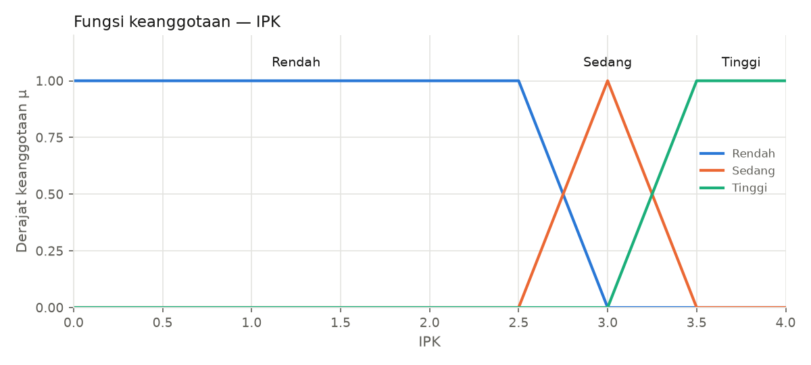

**Alasan parameter.** IPK < 2,50 umumnya di bawah syarat minimum beasiswa sehingga penuh "Rendah". 3,00 adalah syarat umum beasiswa sehingga menjadi puncak "Sedang". IPK ≥ 3,50 setara predikat dengan pujian sehingga penuh "Tinggi".

#### Penghasilan Orang Tua (semesta 0–15 juta Rp/bulan)

| Kategori | Bentuk | Parameter |
|---|---|---|
| Rendah | Trapesium (bahu kiri) | (0, 0, 2, 4) |
| Sedang | Trapesium | (2, 4, 6, 9) |
| Tinggi | Trapesium (bahu kanan) | (6, 9, 15, 15) |

$$\mu_{\mathrm{Rendah}}(x) = \begin{cases} 1, & x \leq 2 \\ \frac{4-x}{4-2}, & 2 < x < 4 \\ 0, & x \geq 4 \end{cases}$$

$$\mu_{\mathrm{Sedang}}(x) = \begin{cases} 0, & x \leq 2 \;\mathrm{atau}\; x \geq 9 \\ \frac{x-2}{4-2}, & 2 < x < 4 \\ 1, & 4 \leq x \leq 6 \\ \frac{9-x}{9-6}, & 6 < x < 9 \end{cases}$$

$$\mu_{\mathrm{Tinggi}}(x) = \begin{cases} 0, & x \leq 6 \\ \frac{x-6}{9-6}, & 6 < x < 9 \\ 1, & x \geq 9 \end{cases}$$

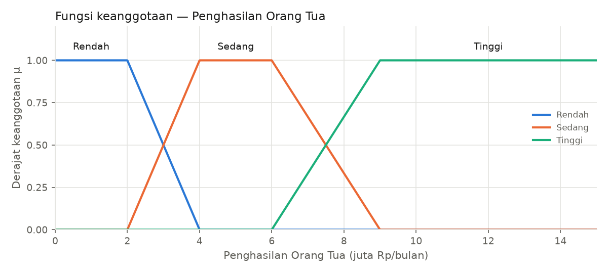

**Alasan parameter.** ≤ Rp2 juta/bulan setara atau di bawah upah minimum di banyak daerah (penuh "Rendah"). Rp4–6 juta dianggap kelas menengah (penuh "Sedang"). ≥ Rp9 juta dianggap mampu (penuh "Tinggi"). Sisi Sedang→Tinggi dibuat lebih landai (6–9 juta) karena perbedaan kemampuan ekonomi di rentang ini lebih kabur.

#### Jumlah Tanggungan Keluarga (semesta 0–8 orang)

| Kategori | Bentuk | Parameter |
|---|---|---|
| Sedikit | Trapesium (bahu kiri) | (0, 0, 1, 3) |
| Sedang | Segitiga | (1, 3, 5) |
| Banyak | Trapesium (bahu kanan) | (3, 5, 8, 8) |

$$\mu_{\mathrm{Sedikit}}(x) = \begin{cases} 1, & x \leq 1 \\ \frac{3-x}{3-1}, & 1 < x < 3 \\ 0, & x \geq 3 \end{cases}$$

$$\mu_{\mathrm{Sedang}}(x) = \begin{cases} 0, & x \leq 1 \;\mathrm{atau}\; x \geq 5 \\ \frac{x-1}{3-1}, & 1 < x \leq 3 \\ \frac{5-x}{5-3}, & 3 < x < 5 \end{cases}$$

$$\mu_{\mathrm{Banyak}}(x) = \begin{cases} 0, & x \leq 3 \\ \frac{x-3}{5-3}, & 3 < x < 5 \\ 1, & x \geq 5 \end{cases}$$

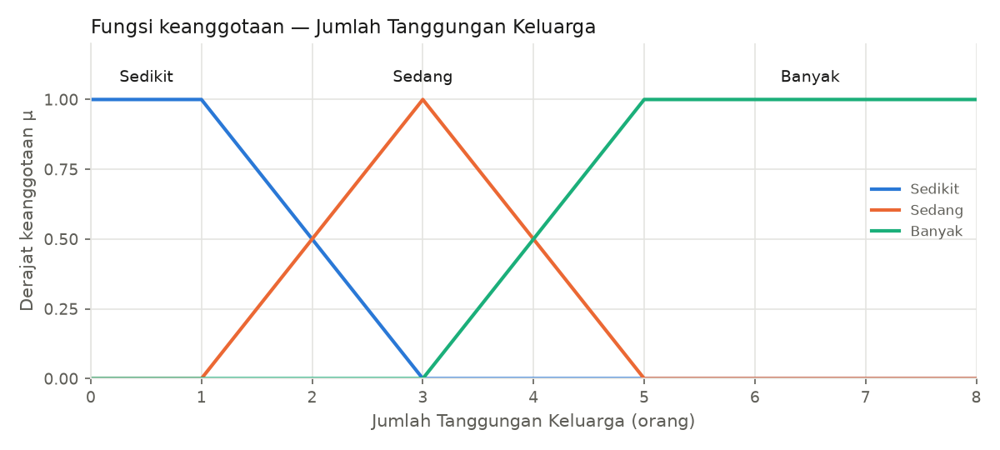

**Alasan parameter.** 0–1 tanggungan berarti beban ringan, 3 tanggungan dianggap keluarga tipikal, dan ≥ 5 tanggungan dianggap beban berat. Variabel ini diperlakukan kontinu agar data rata-rata (misalnya 3,5) tetap dapat diproses.

#### Skor Prestasi (semesta 0–100 skor)

| Kategori | Bentuk | Parameter |
|---|---|---|
| Rendah | Trapesium (bahu kiri) | (0, 0, 30, 50) |
| Sedang | Segitiga | (30, 50, 70) |
| Tinggi | Trapesium (bahu kanan) | (50, 70, 100, 100) |

$$\mu_{\mathrm{Rendah}}(x) = \begin{cases} 1, & x \leq 30 \\ \frac{50-x}{50-30}, & 30 < x < 50 \\ 0, & x \geq 50 \end{cases}$$

$$\mu_{\mathrm{Sedang}}(x) = \begin{cases} 0, & x \leq 30 \;\mathrm{atau}\; x \geq 70 \\ \frac{x-30}{50-30}, & 30 < x \leq 50 \\ \frac{70-x}{70-50}, & 50 < x < 70 \end{cases}$$

$$\mu_{\mathrm{Tinggi}}(x) = \begin{cases} 0, & x \leq 50 \\ \frac{x-50}{70-50}, & 50 < x < 70 \\ 1, & x \geq 70 \end{cases}$$

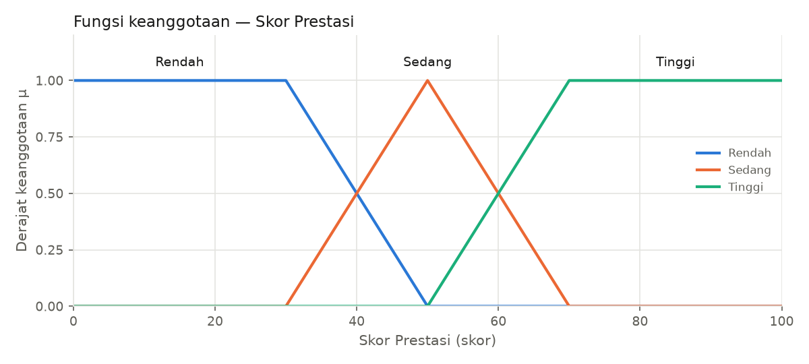

**Alasan parameter.** Skor prestasi (lomba, organisasi, karya) 0–100. Skor ≤ 30 penuh "Rendah", 50 khas "Sedang", ≥ 70 penuh "Tinggi". Lebar transisi 20 poin dipakai seragam.

#### Kelayakan Beasiswa (semesta 0–100 skor)

| Kategori | Bentuk | Parameter |
|---|---|---|
| Tidak Layak | Trapesium (bahu kiri) | (0, 0, 25, 45) |
| Cukup Layak | Segitiga | (25, 45, 65) |
| Layak | Segitiga | (45, 65, 85) |
| Sangat Layak | Trapesium (bahu kanan) | (65, 85, 100, 100) |

$$\mu_{\mathrm{Tidak\;Layak}}(x) = \begin{cases} 1, & x \leq 25 \\ \frac{45-x}{45-25}, & 25 < x < 45 \\ 0, & x \geq 45 \end{cases}$$

$$\mu_{\mathrm{Cukup\;Layak}}(x) = \begin{cases} 0, & x \leq 25 \;\mathrm{atau}\; x \geq 65 \\ \frac{x-25}{45-25}, & 25 < x \leq 45 \\ \frac{65-x}{65-45}, & 45 < x < 65 \end{cases}$$

$$\mu_{\mathrm{Layak}}(x) = \begin{cases} 0, & x \leq 45 \;\mathrm{atau}\; x \geq 85 \\ \frac{x-45}{65-45}, & 45 < x \leq 65 \\ \frac{85-x}{85-65}, & 65 < x < 85 \end{cases}$$

$$\mu_{\mathrm{Sangat\;Layak}}(x) = \begin{cases} 0, & x \leq 65 \\ \frac{x-65}{85-65}, & 65 < x < 85 \\ 1, & x \geq 85 \end{cases}$$

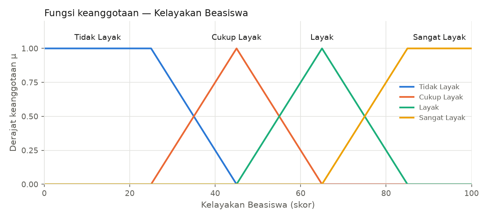

**Alasan parameter.** Empat kategori dengan lebar transisi 20 poin yang seragam. Titik potong 35/55/75 menjadi batas interpretasi skor. Bahu "Tidak Layak" (0–25) dan "Sangat Layak" (85–100) menampung skor ekstrem.

### 2.3 Bukti tidak ada celah

Fungsi `cek_celah_mf()` (file `fuzzy/coverage.py`) menyisir setiap semesta dengan 10.001 titik dan menghitung max μ dari semua kategori di setiap titik. Sistem dinyatakan tanpa celah bila nilai minimum dari max μ tersebut > 0.

| Variabel | Tanpa celah | min(max μ) | Titik terlemah |
|---|---|---|---|
| ipk | True | 0.5 | 2.75 |
| penghasilan | True | 0.5 | 3.0 |
| tanggungan | True | 0.5 | 2.0 |
| prestasi | True | 0.5 | 40.0 |
| kelayakan | True | 0.5 | 35.0 |

Di setiap variabel, titik terlemah adalah titik potong dua kategori dengan μ = 0,5, sehingga setiap nilai input selalu termasuk minimal satu kategori dengan derajat ≥ 0,5.

## 3. Basis Aturan

Basis aturan terdiri atas **22 aturan** yang disusun dalam tiga kelompok. Seluruh anteseden digabung dengan operator AND (MIN). Aturan disimpan sebagai data (list of dict) di `config.py`, bukan sebagai if-else bersarang.

- **Kelompok A (R1–R9): IPK × Penghasilan.** Menggabungkan merit akademik dengan kebutuhan ekonomi.
- **Kelompok B (R10–R18): Prestasi × Tanggungan.** Menggabungkan merit non-akademik dengan beban keluarga.
- **Kelompok C (R19–R22): aturan silang.** Menangkap interaksi penting antar-kelompok.

Konsekuen kelompok A dan B disusun secara sistematis: setiap kategori diberi skor ordinal (Rendah/Sedikit = 0, Sedang = 1, Tinggi/Banyak = 2; untuk penghasilan dibalik karena makin rendah makin membutuhkan). Jumlah skor 0–1 → Tidak Layak, 2 → Cukup Layak, 3 → Layak, 4 → Sangat Layak. Dengan cara ini **tidak ada aturan yang arahnya bertentangan**: menaikkan input yang "baik" tidak pernah memindahkan konsekuen ke kategori yang lebih rendah.

Aturan sengaja memakai sebagian anteseden (2 variabel). Alasannya, aturan lengkap 4 variabel membutuhkan 3⁴ = 81 aturan agar seluruh kombinasi tercakup, sedangkan 15–22 aturan 4-variabel pasti meninggalkan banyak kombinasi tanpa aturan aktif.

| ID | IPK | Penghasilan | Tanggungan | Prestasi | → Kelayakan | Alasan |
|---|---|---|---|---|---|---|
| R1 | Rendah | Rendah | - | - | Cukup Layak | Sangat membutuhkan bantuan, tetapi akademiknya lemah sehingga hanya cukup layak. |
| R2 | Rendah | Sedang | - | - | Tidak Layak | Akademik lemah dan kebutuhan ekonomi tidak mendesak. |
| R3 | Rendah | Tinggi | - | - | Tidak Layak | Tidak unggul secara akademik dan keluarga mampu secara ekonomi. |
| R4 | Sedang | Rendah | - | - | Layak | IPK memenuhi syarat umum dan keluarga membutuhkan bantuan. |
| R5 | Sedang | Sedang | - | - | Cukup Layak | Akademik dan kondisi ekonomi sama-sama menengah. |
| R6 | Sedang | Tinggi | - | - | Tidak Layak | Keluarga mampu dan IPK tidak menonjol. |
| R7 | Tinggi | Rendah | - | - | Sangat Layak | Unggul secara akademik dan sangat membutuhkan bantuan. |
| R8 | Tinggi | Sedang | - | - | Layak | Unggul secara akademik dengan kebutuhan ekonomi sedang. |
| R9 | Tinggi | Tinggi | - | - | Cukup Layak | Unggul secara akademik, tetapi keluarga mampu sehingga prioritas turun. |
| R10 | - | - | Sedikit | Rendah | Tidak Layak | Prestasi rendah dan beban keluarga ringan. |
| R11 | - | - | Sedang | Rendah | Tidak Layak | Beban keluarga sedang belum menutupi prestasi yang rendah. |
| R12 | - | - | Banyak | Rendah | Cukup Layak | Beban keluarga berat memberi pertimbangan meskipun prestasi rendah. |
| R13 | - | - | Sedikit | Sedang | Tidak Layak | Prestasi biasa dan beban keluarga ringan. |
| R14 | - | - | Sedang | Sedang | Cukup Layak | Prestasi dan beban keluarga sama-sama menengah. |
| R15 | - | - | Banyak | Sedang | Layak | Beban keluarga berat dengan prestasi yang memadai. |
| R16 | - | - | Sedikit | Tinggi | Cukup Layak | Berprestasi, tetapi beban keluarga ringan. |
| R17 | - | - | Sedang | Tinggi | Layak | Berprestasi dengan beban keluarga sedang. |
| R18 | - | - | Banyak | Tinggi | Sangat Layak | Berprestasi dan menanggung beban keluarga yang berat. |
| R19 | Rendah | - | - | Rendah | Tidak Layak | Gagal memenuhi standar akademik minimum dari dua sisi (IPK dan prestasi). |
| R20 | - | Tinggi | Sedikit | - | Tidak Layak | Penghasilan tinggi dengan beban ringan berarti tidak membutuhkan bantuan. |
| R21 | - | Rendah | Banyak | - | Layak | Kebutuhan ekonomi sangat mendesak (miskin dengan banyak tanggungan). |
| R22 | Tinggi | - | - | Tinggi | Layak | Merit akademik kuat dari dua sisi (IPK dan prestasi). |

Tanda "-" berarti variabel tersebut tidak dipakai pada anteseden aturan itu.

### 3.1 Uji cakupan aturan

Skrip `scripts/uji_cakupan.py` menyisir grid seluruh kombinasi empat input pada tiga resolusi dan menghitung α semua aturan di setiap titik grid (tervektorisasi dengan NumPy). Sebuah kombinasi dikatakan tercakup bila minimal satu aturan memiliki α > 0.

| Titik/variabel | Total kombinasi | Tercakup | Persen | Aturan aktif min–maks (rata-rata) | min(α maks) |
|---|---|---|---|---|---|
| 20 | 160,000 | 160,000 | 100.00% | 2–10 (4.64) | 0.553 |
| 30 | 810,000 | 810,000 | 100.00% | 2–10 (4.63) | 0.534 |
| 40 | 2,560,000 | 2,560,000 | 100.00% | 2–10 (4.65) | 0.538 |

Selain grid numerik, dicek juga secara logis bahwa 81 dari 81 kombinasi kategori (3⁴) memiliki minimal satu aturan yang cocok. **Hasil: cakupan 100%, tidak ada kombinasi yang perlu diperbaiki.** Secara teoretis hal ini dijamin oleh kelompok A: untuk sembarang nilai input selalu ada satu kategori IPK dan satu kategori penghasilan dengan μ ≥ 0,5, dan kelompok A memuat seluruh 3 × 3 pasangan tersebut. Karena itu α maks di setiap titik selalu ≥ 0,5, dan setiap titik mengaktifkan minimal 2 aturan.

## 4. Implementasi Metode Mamdani

Mesin inferensi ditulis sendiri dengan Python + NumPy agar setiap tahap dapat diperiksa. `scikit-fuzzy` hanya dipakai sebagai pembanding pada tahap validasi.

| Komponen | File | Keterangan |
|---|---|---|
| Parameter MF, grid output, aturan | `config.py` | Satu-satunya tempat mengubah parameter |
| Fungsi segitiga & trapesium | `fuzzy/membership.py` | `segitiga()`, `trapesium()`, `hitung_mf()` |
| Fuzzifikasi → centroid | `fuzzy/engine.py` | `fuzzifikasi()`, `alpha_predikat()`, `implikasi()`, `agregasi()`, `centroid()` |
| Cek celah & cakupan | `fuzzy/coverage.py` | `cek_celah_mf()`, `cek_cakupan_aturan()` |
| Antarmuka web | `app.py` | Streamlit |

Tahapan inferensi untuk satu mahasiswa:

1. **Fuzzifikasi**: setiap nilai crisp diubah menjadi derajat keanggotaan μ di setiap kategori.
2. **α-predikat**: untuk setiap aturan, α = MIN(μ anteseden).
3. **Implikasi MIN**: fungsi output konsekuen dipotong setinggi α, yaitu μ_i(z) = min(α_i, μ_konsekuen(z)).
4. **Agregasi MAX**: μ_agr(z) = max_i μ_i(z) atas semua aturan.
5. **Defuzzifikasi centroid diskrit** pada grid output.

**Grid output:** z = 0; 0.1; 0.2; …; 100, yaitu langkah Δz = 0.1 dengan **1001 titik sampel**.

$$z^* = \frac{\sum_{i=1}^{N} \mu_{agr}(z_i)\, z_i}{\sum_{i=1}^{N} \mu_{agr}(z_i)}$$

Potongan inti kode (`fuzzy/engine.py`):

```python
def alpha_predikat(mu, rules):
    for r in rules:                                   # AND = MIN
        komponen = {var: mu[var][kat] for var, kat in r['if'].items()}
        alpha = min(komponen.values())

def implikasi(alphas, z):                             # implikasi MIN (clipping)
    return [np.minimum(a['alpha'], mf_out[a['then']]) for a in alphas]

def agregasi(terpotong, z):                           # agregasi MAX
    return np.max(np.vstack(terpotong), axis=0)

def centroid(z, mu):                                  # Σμ·z / Σμ
    return np.sum(mu * z) / np.sum(mu)
```

Nilai input di luar semesta dipotong (clip) ke batas semesta, misalnya IPK 4,2 diperlakukan sebagai 4,0.

## 5. Contoh Perhitungan Lengkap

Mahasiswa yang dipilih adalah **M09 (Indah)** dengan IPK 3.3, penghasilan Rp3.5 juta, tanggungan 4 orang, dan prestasi 62. Keempat nilainya berada di daerah tumpang tindih dua kategori, sehingga banyak aturan aktif dan setiap tahap Mamdani terlihat jelas.

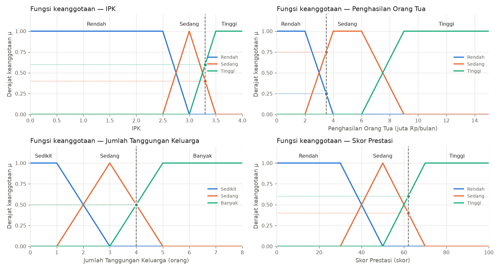

### 5.0 Data mahasiswa

| Variabel | Nilai |
|---|---|
| IPK | 3.3  |
| Penghasilan Orang Tua | 3.5 juta Rp/bulan |
| Jumlah Tanggungan Keluarga | 4 orang |
| Skor Prestasi | 62 skor |

### 5.1 Langkah 1 — Fuzzifikasi

| Variabel | Kategori | Parameter | Substitusi | μ |
|---|---|---|---|---|
| IPK | Rendah | trap(0, 0, 2.5, 3) | x ≤ 0 atau x ≥ 3 → μ = 0 | **0.0000** |
| IPK | Sedang | tri(2.5, 3, 3.5) | (d − x)/(d − c) = (3.5 − 3.3) / (3.5 − 3) = 0.4000 | **0.4000** |
| IPK | Tinggi | trap(3, 3.5, 4, 4) | (x − a)/(b − a) = (3.3 − 3) / (3.5 − 3) = 0.6000 | **0.6000** |
| Penghasilan Orang Tua | Rendah | trap(0, 0, 2, 4) | (d − x)/(d − c) = (4 − 3.5) / (4 − 2) = 0.2500 | **0.2500** |
| Penghasilan Orang Tua | Sedang | trap(2, 4, 6, 9) | (x − a)/(b − a) = (3.5 − 2) / (4 − 2) = 0.7500 | **0.7500** |
| Penghasilan Orang Tua | Tinggi | trap(6, 9, 15, 15) | x ≤ 6 atau x ≥ 15 → μ = 0 | **0.0000** |
| Jumlah Tanggungan Keluarga | Sedikit | trap(0, 0, 1, 3) | x ≤ 0 atau x ≥ 3 → μ = 0 | **0.0000** |
| Jumlah Tanggungan Keluarga | Sedang | tri(1, 3, 5) | (d − x)/(d − c) = (5 − 4) / (5 − 3) = 0.5000 | **0.5000** |
| Jumlah Tanggungan Keluarga | Banyak | trap(3, 5, 8, 8) | (x − a)/(b − a) = (4 − 3) / (5 − 3) = 0.5000 | **0.5000** |
| Skor Prestasi | Rendah | trap(0, 0, 30, 50) | x ≤ 0 atau x ≥ 50 → μ = 0 | **0.0000** |
| Skor Prestasi | Sedang | tri(30, 50, 70) | (d − x)/(d − c) = (70 − 62) / (70 − 50) = 0.4000 | **0.4000** |
| Skor Prestasi | Tinggi | trap(50, 70, 100, 100) | (x − a)/(b − a) = (62 − 50) / (70 − 50) = 0.6000 | **0.6000** |

### 5.2 Langkah 2 — α-predikat setiap aturan (AND = MIN)

| Aturan | Anteseden | MIN(...) | α | Konsekuen |
|---|---|---|---|---|
| R1 | IPK Rendah ∧ Penghasilan Orang Tua Rendah | MIN(0.0000, 0.2500) | 0 | Cukup Layak |
| R2 | IPK Rendah ∧ Penghasilan Orang Tua Sedang | MIN(0.0000, 0.7500) | 0 | Tidak Layak |
| R3 | IPK Rendah ∧ Penghasilan Orang Tua Tinggi | MIN(0.0000, 0.0000) | 0 | Tidak Layak |
| R4 | IPK Sedang ∧ Penghasilan Orang Tua Rendah | MIN(0.4000, 0.2500) | **0.2500** | Layak |
| R5 | IPK Sedang ∧ Penghasilan Orang Tua Sedang | MIN(0.4000, 0.7500) | **0.4000** | Cukup Layak |
| R6 | IPK Sedang ∧ Penghasilan Orang Tua Tinggi | MIN(0.4000, 0.0000) | 0 | Tidak Layak |
| R7 | IPK Tinggi ∧ Penghasilan Orang Tua Rendah | MIN(0.6000, 0.2500) | **0.2500** | Sangat Layak |
| R8 | IPK Tinggi ∧ Penghasilan Orang Tua Sedang | MIN(0.6000, 0.7500) | **0.6000** | Layak |
| R9 | IPK Tinggi ∧ Penghasilan Orang Tua Tinggi | MIN(0.6000, 0.0000) | 0 | Cukup Layak |
| R10 | Skor Prestasi Rendah ∧ Jumlah Tanggungan Keluarga Sedikit | MIN(0.0000, 0.0000) | 0 | Tidak Layak |
| R11 | Skor Prestasi Rendah ∧ Jumlah Tanggungan Keluarga Sedang | MIN(0.0000, 0.5000) | 0 | Tidak Layak |
| R12 | Skor Prestasi Rendah ∧ Jumlah Tanggungan Keluarga Banyak | MIN(0.0000, 0.5000) | 0 | Cukup Layak |
| R13 | Skor Prestasi Sedang ∧ Jumlah Tanggungan Keluarga Sedikit | MIN(0.4000, 0.0000) | 0 | Tidak Layak |
| R14 | Skor Prestasi Sedang ∧ Jumlah Tanggungan Keluarga Sedang | MIN(0.4000, 0.5000) | **0.4000** | Cukup Layak |
| R15 | Skor Prestasi Sedang ∧ Jumlah Tanggungan Keluarga Banyak | MIN(0.4000, 0.5000) | **0.4000** | Layak |
| R16 | Skor Prestasi Tinggi ∧ Jumlah Tanggungan Keluarga Sedikit | MIN(0.6000, 0.0000) | 0 | Cukup Layak |
| R17 | Skor Prestasi Tinggi ∧ Jumlah Tanggungan Keluarga Sedang | MIN(0.6000, 0.5000) | **0.5000** | Layak |
| R18 | Skor Prestasi Tinggi ∧ Jumlah Tanggungan Keluarga Banyak | MIN(0.6000, 0.5000) | **0.5000** | Sangat Layak |
| R19 | IPK Rendah ∧ Skor Prestasi Rendah | MIN(0.0000, 0.0000) | 0 | Tidak Layak |
| R20 | Penghasilan Orang Tua Tinggi ∧ Jumlah Tanggungan Keluarga Sedikit | MIN(0.0000, 0.0000) | 0 | Tidak Layak |
| R21 | Penghasilan Orang Tua Rendah ∧ Jumlah Tanggungan Keluarga Banyak | MIN(0.2500, 0.5000) | **0.2500** | Layak |
| R22 | IPK Tinggi ∧ Skor Prestasi Tinggi | MIN(0.6000, 0.6000) | **0.6000** | Layak |

Aturan aktif (α > 0): **10** dari 22 — R4, R5, R7, R8, R14, R15, R17, R18, R21, R22.

### 5.3 Langkah 3 — Implikasi MIN (clipping)

Untuk setiap aturan aktif i: μ_i(z) = min(α_i, μ_konsekuen(z)). Jika beberapa aturan memiliki konsekuen sama, yang menentukan bentuk akhir adalah α terbesar:

| Kategori output | Aturan aktif | α terbesar (tinggi potongan) |
|---|---|---|
| Tidak Layak | – | 0 |
| Cukup Layak | R5 (0.4000), R14 (0.4000) | **0.4000** |
| Layak | R4 (0.2500), R8 (0.6000), R15 (0.4000), R17 (0.5000), R21 (0.2500), R22 (0.6000) | **0.6000** |
| Sangat Layak | R7 (0.2500), R18 (0.5000) | **0.5000** |

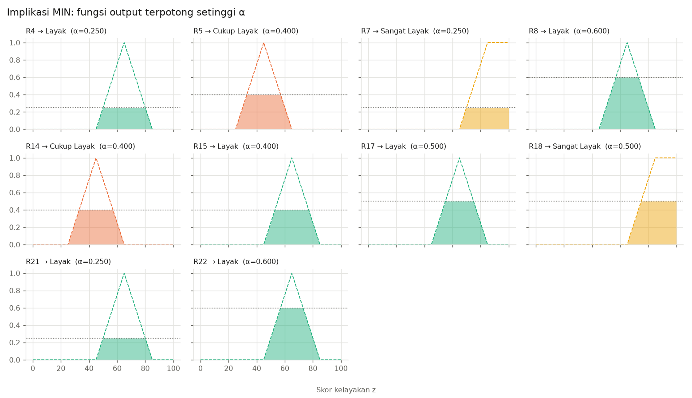

### 5.4 Langkah 4 — Agregasi MAX

μ_agr(z) = max_i μ_i(z) = max over kategori k dari min(α_k, μ_k(z)), dengan α_k = tinggi potongan pada tabel di atas.

Contoh nilai μ_agr pada beberapa titik z:

| z | min(α, μ_Tidak Layak) | min(α, μ_Cukup Layak) | min(α, μ_Layak) | min(α, μ_Sangat Layak) | μ_agr(z) |
|---|---|---|---|---|---|
| 0 | 0.0000 | 0.0000 | 0.0000 | 0.0000 | **0.0000** |
| 10 | 0.0000 | 0.0000 | 0.0000 | 0.0000 | **0.0000** |
| 20 | 0.0000 | 0.0000 | 0.0000 | 0.0000 | **0.0000** |
| 30 | 0.0000 | 0.2500 | 0.0000 | 0.0000 | **0.2500** |
| 35 | 0.0000 | 0.4000 | 0.0000 | 0.0000 | **0.4000** |
| 40 | 0.0000 | 0.4000 | 0.0000 | 0.0000 | **0.4000** |
| 45 | 0.0000 | 0.4000 | 0.0000 | 0.0000 | **0.4000** |
| 50 | 0.0000 | 0.4000 | 0.2500 | 0.0000 | **0.4000** |
| 55 | 0.0000 | 0.4000 | 0.5000 | 0.0000 | **0.5000** |
| 60 | 0.0000 | 0.2500 | 0.6000 | 0.0000 | **0.6000** |
| 65 | 0.0000 | 0.0000 | 0.6000 | 0.0000 | **0.6000** |
| 70 | 0.0000 | 0.0000 | 0.6000 | 0.2500 | **0.6000** |
| 75 | 0.0000 | 0.0000 | 0.5000 | 0.5000 | **0.5000** |
| 80 | 0.0000 | 0.0000 | 0.2500 | 0.5000 | **0.5000** |
| 85 | 0.0000 | 0.0000 | 0.0000 | 0.5000 | **0.5000** |
| 90 | 0.0000 | 0.0000 | 0.0000 | 0.5000 | **0.5000** |
| 100 | 0.0000 | 0.0000 | 0.0000 | 0.5000 | **0.5000** |

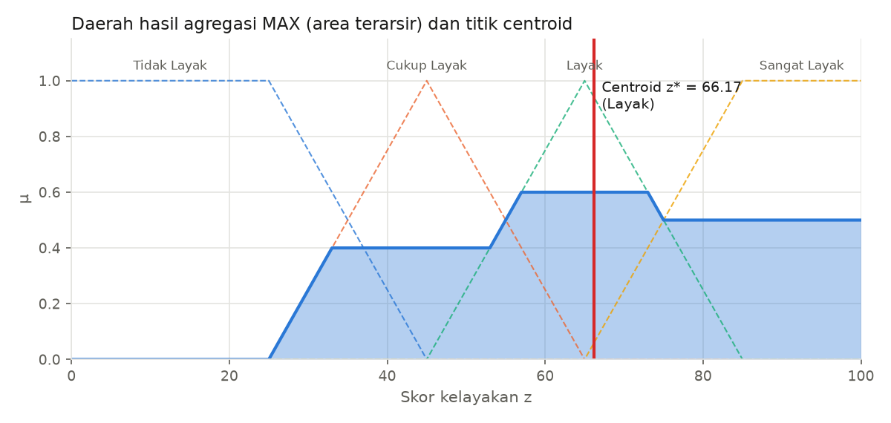

### 5.5 Langkah 5 — Defuzzifikasi centroid (diskrit)

Grid output: z = 0, 0.1, 0.2, …, 100 (langkah Δz = 0.1, **1001 titik**).

$$z^* = \frac{\sum_{i} \mu_{agr}(z_i)\, z_i}{\sum_{i} \mu_{agr}(z_i)} = \frac{23044.1750}{348.2500} = 66.1714$$

**Skor kelayakan = 66.17 → kategori _Layak_** (rekomendasi, bukan keputusan final).

Interpretasi: aturan dengan α terbesar mengarah ke **Layak** (R8, R22; α = 0,6). Kontribusi **Sangat Layak** (α = 0,5) menarik centroid ke kanan, sedangkan **Cukup Layak** (α = 0,4) menariknya ke kiri. Keseimbangan ketiganya menghasilkan skor sedikit di atas puncak Layak (65).

## 6. Pengujian

Data uji berisi **22 mahasiswa simulasi** (`data/data_mahasiswa.csv`) yang mencakup kondisi ekstrem, nilai tepat di titik parameter, daerah tumpang tindih, kriteria bertentangan, dan kasus normal. Hasil lengkap (input, μ setiap kategori, daftar aturan aktif beserta α, skor, dan kategori) tersimpan di `hasil/hasil_uji.csv`. Ringkasannya:

| ID | Nama | IPK | Penghasilan (jt) | Tanggungan | Prestasi | Aturan aktif | Skor | Kategori | Jenis uji |
|---|---|---|---|---|---|---|---|---|---|
| M01 | Andi | 4.0 | 0.0 | 8.0 | 100 | 4 | 77.42 | Sangat Layak | Ekstrem: semua sangat baik (nilai batas semesta) |
| M02 | Budi | 0.0 | 15.0 | 0.0 | 0 | 4 | 17.95 | Tidak Layak | Ekstrem: semua sangat buruk (nilai batas semesta) |
| M03 | Citra | 4.0 | 15.0 | 8.0 | 100 | 3 | 67.68 | Layak | Ekstrem: semua nilai maksimum semesta |
| M04 | Dewi | 0.0 | 0.0 | 0.0 | 0 | 3 | 27.06 | Tidak Layak | Ekstrem: semua nilai nol |
| M05 | Eka | 3.0 | 4.0 | 3.0 | 50 | 2 | 45.00 | Cukup Layak | Batas: tepat di puncak kategori Sedang |
| M06 | Fajar | 3.5 | 2.0 | 5.0 | 70 | 4 | 77.42 | Sangat Layak | Batas: tepat di awal bahu Tinggi/Rendah/Banyak |
| M07 | Gita | 2.5 | 9.0 | 1.0 | 30 | 4 | 17.95 | Tidak Layak | Batas: tepat di ujung bahu (2.5; 9; 1; 30) |
| M08 | Hadi | 3.5 | 6.0 | 1.0 | 30 | 2 | 35.04 | Cukup Layak | Batas: campuran titik parameter |
| M09 | Indah | 3.3 | 3.5 | 4.0 | 62 | 10 | 66.17 | Layak | Tumpang tindih: semua input di daerah overlap |
| M10 | Joko | 2.75 | 3.0 | 2.0 | 40 | 9 | 40.03 | Cukup Layak | Tumpang tindih: semua input tepat mu=0.5 |
| M11 | Kirana | 3.2 | 7.5 | 3.5 | 58 | 9 | 44.13 | Cukup Layak | Tumpang tindih: penghasilan Sedang-Tinggi |
| M12 | Lukman | 3.9 | 12.0 | 2.0 | 85 | 5 | 43.02 | Cukup Layak | Bertentangan: IPK & prestasi tinggi tetapi keluarga kaya |
| M13 | Maya | 2.1 | 0.8 | 7.0 | 25 | 4 | 36.57 | Cukup Layak | Bertentangan: IPK rendah tetapi sangat miskin & tanggungan banyak |
| M14 | Nanda | 2.3 | 3.0 | 3.0 | 90 | 3 | 42.80 | Cukup Layak | Bertentangan: prestasi tinggi tetapi IPK rendah |
| M15 | Oki | 3.8 | 1.5 | 2.0 | 15 | 3 | 57.19 | Layak | Bertentangan: IPK tinggi & miskin tetapi prestasi rendah |
| M16 | Putri | 3.0 | 11.0 | 7.0 | 55 | 3 | 38.64 | Cukup Layak | Bertentangan: tanggungan banyak tetapi penghasilan tinggi |
| M17 | Rizky | 3.45 | 5.2 | 3.0 | 66 | 5 | 60.29 | Layak | Normal |
| M18 | Sari | 2.9 | 2.8 | 4.0 | 48 | 10 | 48.59 | Cukup Layak | Normal |
| M19 | Tono | 3.6 | 4.0 | 2.0 | 75 | 4 | 56.67 | Layak | Normal |
| M20 | Umi | 3.1 | 6.5 | 5.0 | 40 | 6 | 48.24 | Cukup Layak | Normal |
| M21 | Vina | 3.75 | 2.5 | 6.0 | 80 | 5 | 77.42 | Sangat Layak | Normal |
| M22 | Wahyu | 2.6 | 8.0 | 2.0 | 35 | 10 | 24.03 | Tidak Layak | Normal |

Contoh isi kolom aturan aktif (M09): `R4(0.250)->Layak; R5(0.400)->Cukup Layak; R7(0.250)->Sangat Layak; R8(0.600)->Layak; R14(0.400)->Cukup Layak; R15(0.400)->Layak; R17(0.500)->Layak; R18(0.500)->Sangat Layak; R21(0.250)->Layak; R22(0.600)->Layak`.

Distribusi kategori: Tidak Layak 4, Cukup Layak 10, Layak 5, Sangat Layak 3.

### 6.1 Komentar kewajaran hasil

**Kasus ekstrem.**

- M01 (semua sangat baik) mendapat 77,42 (Sangat Layak) dan M02 (semua sangat buruk) mendapat 17,95 (Tidak Layak). Urutannya benar. Kedua skor ini adalah batas atas dan bawah yang dapat dicapai sistem. Skor tidak mencapai 100 atau 0 karena **efek kompresi centroid**: titik berat daerah "Sangat Layak" sendiri berada di sekitar 87, dan pada kasus terbaik aturan R21/R22 (→ Layak) juga aktif penuh sehingga centroid bergeser ke sekitar 77.
- M03 (semua nilai maksimum: IPK 4, prestasi 100, tanggungan 8, tetapi penghasilan 15 juta) mendapat 67,68 (Layak). Hasil ini wajar karena merit dan beban keluarga sangat tinggi, tetapi keluarga mampu (R9 → Cukup Layak) sehingga tidak mencapai Sangat Layak.
- M04 (semua nol) mendapat 27,06 (Tidak Layak). Keluarga sangat miskin (R1 → Cukup Layak), tetapi IPK dan prestasi nol (R19 → Tidak Layak) serta tanggungan sedikit (R10 → Tidak Layak). Hasilnya wajar.

**Kasus batas (tepat di titik parameter).**

- M05 (IPK 3,0; penghasilan 4; tanggungan 3; prestasi 50, semuanya tepat di puncak "Sedang") mendapat 45,00 (Cukup Layak). Hanya R5 dan R14 (→ Cukup Layak, α = 1) yang aktif, sehingga centroid tepat berada di puncak segitiga Cukup Layak (45). Ini menjadi bukti engine bekerja simetris dan benar.
- M06 (3,5; 2; 5; 70, tepat di awal μ = 1 kategori terbaik) mendapat 77,42 (Sangat Layak), sama persis dengan M01. Kesamaan ini benar karena pada titik tersebut μ kategori terbaik sudah 1.
- M07 (2,5; 9; 1; 30) mendapat 17,95 (Tidak Layak), sama dengan M02, dengan alasan yang sama.
- M08 (IPK 3,5 penuh Tinggi, penghasilan 6 penuh Sedang, tanggungan 1, prestasi 30) mendapat 35,04 (Cukup Layak). R8 (→ Layak) dan R10 (→ Tidak Layak) sama-sama aktif dengan α = 1, sehingga centroid jatuh di tengah, tepat di sekitar batas Tidak Layak/Cukup Layak. Panitia sebaiknya meninjau kasus seperti ini secara manual.

**Kasus tumpang tindih.**

- M09 66,17 (Layak), M10 40,03 (Cukup Layak), dan M11 44,13 (Cukup Layak) mengaktifkan 9–10 aturan. Skornya berada di antara kategori yang aktif, dan perubahan kecil input hanya menggeser skor secara halus (tidak melompat). Inilah keunggulan fuzzy dibanding ambang tegas.

**Kasus bertentangan.**

- M12 (IPK 3,9 dan prestasi 85, tetapi penghasilan 12 juta dan tanggungan 2) mendapat 43,02 (Cukup Layak). Merit tinggi diimbangi oleh keluarga yang mampu. Hasil ini sesuai tujuan beasiswa berbasis kebutuhan.
- M13 (IPK 2,1 dan prestasi 25, tetapi sangat miskin dengan 7 tanggungan) mendapat 36,57 (Cukup Layak). Empat aturan aktif penuh dengan konsekuen berbeda (TL, CL, CL, L), sehingga hasilnya berada di tengah. Sistem tidak menolak mentah-mentah, tetapi juga tidak memprioritaskan.
- M14 (prestasi 90, tetapi IPK 2,3) mendapat 42,80 (Cukup Layak). M15 (IPK 3,8 dan miskin, tetapi prestasi 15) mendapat 57,19 (Layak). M15 lebih tinggi karena IPK berpasangan dengan penghasilan rendah di R7 (→ Sangat Layak). Ini menunjukkan bahwa dalam basis aturan ini **kombinasi IPK–penghasilan berbobot lebih besar daripada prestasi**, sesuai pola beasiswa umum yang mensyaratkan IPK.
- M16 (tanggungan 7, tetapi penghasilan 11 juta) mendapat 38,64 (Cukup Layak). Penghasilan tinggi lebih dominan daripada jumlah tanggungan. Hasilnya wajar.

**Kasus normal.** Skor M17–M22 tersebar dari Tidak Layak (M22, IPK 2,6 dengan penghasilan 8 juta) sampai Sangat Layak (M21, IPK 3,75, penghasilan 2,5 juta, tanggungan 6, prestasi 80). Urutannya sesuai intuisi.

Secara keseluruhan, tidak ditemukan hasil yang janggal. Rentang skor efektif sistem adalah 17.95–77.42, bukan 0–100. Hal ini dibahas lebih lanjut di Bab 8.

## 7. Validasi dan Analisis Sensitivitas

### 7.1 Validasi perhitungan manual vs program

Perhitungan manual ditulis ulang secara terpisah di `scripts/validasi.py` (fungsi `manual()`). Perhitungan ini memakai Python murni tanpa NumPy dan tanpa memanggil engine maupun `config.py`. Setiap rumus MF diketik langsung beserta angka parameternya (misalnya `(3.0 - x) / (3.0 - 2.5)`), setiap aturan ditulis satu per satu, lalu agregasi dan centroid dihitung dengan perulangan biasa pada grid yang sama (Δz = 0,1).


#### M09 Indah (tumpang tindih): IPK=3.3, penghasilan=3.5, tanggungan=4, prestasi=62

- Fuzzifikasi: IPK(R,S,T)=(0.0000, 0.4000, 0.6000); Penghasilan(R,S,T)=(0.2500, 0.7500, 0.0000); Tanggungan(Sd,S,B)=(0.0000, 0.5000, 0.5000); Prestasi(R,S,T)=(0.0000, 0.4000, 0.6000)
- α aktif: R4=0.2500→L, R5=0.4000→CL, R7=0.2500→SL, R8=0.6000→L, R14=0.4000→CL, R15=0.4000→L, R17=0.5000→L, R18=0.5000→SL, R21=0.2500→L, R22=0.6000→L
- Tinggi potongan: TL=0.0000, CL=0.4000, L=0.6000, SL=0.5000
- Centroid: Σμz / Σμ = 23044.1750 / 348.2500 = 66.1714
- **Manual = 66.171357; Program = 66.171357; selisih = 1.28e-13; scikit-fuzzy = 66.147031**

#### M13 Maya (bertentangan): IPK=2.1, penghasilan=0.8, tanggungan=7, prestasi=25

- Fuzzifikasi: IPK(R,S,T)=(1.0000, 0.0000, 0.0000); Penghasilan(R,S,T)=(1.0000, 0.0000, 0.0000); Tanggungan(Sd,S,B)=(0.0000, 0.0000, 1.0000); Prestasi(R,S,T)=(1.0000, 0.0000, 0.0000)
- α aktif: R1=1.0000→CL, R12=1.0000→CL, R19=1.0000→TL, R21=1.0000→L
- Tinggi potongan: TL=1.0000, CL=1.0000, L=1.0000, SL=0.0000
- Centroid: Σμz / Σμ = 23791.6500 / 650.5000 = 36.5744
- **Manual = 36.574404; Program = 36.574404; selisih = 0.00e+00; scikit-fuzzy = 36.602564**

#### M17 Rizky (normal): IPK=3.45, penghasilan=5.2, tanggungan=3, prestasi=66

- Fuzzifikasi: IPK(R,S,T)=(0.0000, 0.1000, 0.9000); Penghasilan(R,S,T)=(0.0000, 1.0000, 0.0000); Tanggungan(Sd,S,B)=(0.0000, 1.0000, 0.0000); Prestasi(R,S,T)=(0.0000, 0.2000, 0.8000)
- α aktif: R5=0.1000→CL, R8=0.9000→L, R14=0.2000→CL, R17=0.8000→L, R22=0.8000→L
- Tinggi potongan: TL=0.0000, CL=0.2000, L=0.9000, SL=0.0000
- Centroid: Σμz / Σμ = 14350.0000 / 238.0000 = 60.2941
- **Manual = 60.294118; Program = 60.294118; selisih = 6.39e-14; scikit-fuzzy = 60.294118**

#### M12 Lukman (bertentangan): IPK=3.9, penghasilan=12.0, tanggungan=2, prestasi=85

- Fuzzifikasi: IPK(R,S,T)=(0.0000, 0.0000, 1.0000); Penghasilan(R,S,T)=(0.0000, 0.0000, 1.0000); Tanggungan(Sd,S,B)=(0.5000, 0.5000, 0.0000); Prestasi(R,S,T)=(0.0000, 0.0000, 1.0000)
- α aktif: R9=1.0000→CL, R16=0.5000→CL, R17=0.5000→L, R20=0.5000→TL, R22=1.0000→L
- Tinggi potongan: TL=0.5000, CL=1.0000, L=1.0000, SL=0.0000
- Centroid: Σμz / Σμ = 21520.8250 / 500.2500 = 43.0201
- **Manual = 43.020140; Program = 43.020140; selisih = 2.13e-14; scikit-fuzzy = 43.041667**


| Kasus | Manual | Program | |Manual − Program| | scikit-fuzzy | |Program − skfuzzy| |
|---|---|---|---|---|---|
| M09 Indah (tumpang tindih) | 66.1714 | 66.1714 | 1.3e-13 | 66.1470 | 0.0243 |
| M13 Maya (bertentangan) | 36.5744 | 36.5744 | 0.0e+00 | 36.6026 | 0.0282 |
| M17 Rizky (normal) | 60.2941 | 60.2941 | 6.4e-14 | 60.2941 | 0.0000 |
| M12 Lukman (bertentangan) | 43.0201 | 43.0201 | 2.1e-14 | 43.0417 | 0.0215 |

**Hasil:** perhitungan manual dan program identik. Selisihnya hanya sekitar 10⁻¹³, yaitu sisa pembulatan bilangan floating point.

**Pembanding scikit-fuzzy:** sistem yang sama (MF, aturan, AND = MIN, implikasi MIN, agregasi MAX, centroid) dibangun dengan `skfuzzy.control`. Selisihnya sekitar 0,02 poin. Penyebabnya adalah perbedaan cara menghitung centroid: scikit-fuzzy menghitung centroid **kontinu** (integral luas per segmen linear), sedangkan engine ini memakai **jumlahan diskrit**. Buktinya, bila grid engine diperhalus menjadi Δz = 0,001, skornya praktis sama dengan scikit-fuzzy (lihat tabel 7.2). Pada M17 selisihnya 0 karena daerah agregasinya simetris.

### 7.2 Efek resolusi grid centroid

| kasus | acuan_langkah_0.001 | langkah_0.01 | langkah_0.1 | langkah_0.5 | langkah_1 | langkah_2 | langkah_5 | langkah_10 |
|---|---|---|---|---|---|---|---|---|
| M09 Indah (tumpang tindih) | 66.1473 | 66.1495 | 66.1714 | 66.2688 | 66.3909 | 66.6289 | 67.4825 | 68.4 |
| M13 Maya (bertentangan) | 36.6023 | 36.5997 | 36.5744 | 36.4617 | 36.3206 | 36.0455 | 35.1852 | 33.9286 |
| M17 Rizky (normal) | 60.2941 | 60.2941 | 60.2941 | 60.2941 | 60.2941 | 60.2941 | 60.3191 | 60.0 |
| M12 Lukman (bertentangan) | 43.0415 | 43.0395 | 43.0201 | 42.9339 | 42.8259 | 42.6139 | 41.9512 | 40.9524 |

Makin kasar grid, makin besar galat. Dengan Δz = 0,1 galatnya < 0,03 poin, jauh lebih kecil daripada lebar kategori (20 poin), sehingga Δz = 0,1 sudah memadai. Dengan Δz = 5 atau 10 galatnya bisa mencapai 1–3 poin dan dapat memindahkan kategori pada kasus yang dekat batas.

### 7.3 Analisis sensitivitas

Setiap input diubah dari minimum ke maksimum semesta dalam 401 langkah, sementara tiga input lain ditahan pada nilai dasar IPK 3.2, penghasilan 4.5 juta, tanggungan 4, dan prestasi 60 (skor dasar 63.99). Data lengkap ada di `hasil/sensitivitas.csv`.

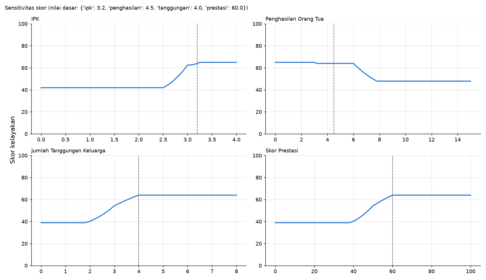

| Variabel | Skor di min | Skor di maks | Rentang | Arah diharapkan | Monoton | Titik paling tajam | Kemiringan maks/satuan | Plateau (skor konstan) |
|---|---|---|---|---|---|---|---|---|
| ipk | 41.945 | 64.97 | 23.025 | naik | Ya | 2.995 | 61.837 | [0–2.5] skor≈41.95; [3.5–4] skor≈64.97 |
| penghasilan | 64.967 | 47.897 | 17.071 | turun | Ya | 6.0187 | 11.627 | [0–2.775] skor≈64.97; [3.225–6] skor≈63.99; [7.8–15] skor≈47.90 |
| tanggungan | 38.947 | 63.99 | 25.042 | naik | Ya | 2.99 | 19.432 | [0–1.8] skor≈38.95; [4–8] skor≈63.99 |
| prestasi | 38.947 | 63.99 | 25.042 | naik | Ya | 49.875 | 1.94 | [0–38] skor≈38.95; [60–100] skor≈63.99 |

**Pola umum.** Keempat kurva **monoton** sesuai arah yang diharapkan: IPK, tanggungan, dan prestasi naik, sedangkan penghasilan turun. Tidak ada lompatan diskontinu; perubahan terbesar per langkah < 0,7 poin. Kurva berbentuk *tangga landai*: datar (plateau) di daerah μ = 1 sebuah kategori dan berubah hanya di daerah transisi tempat μ berubah. Dua mekanisme menjelaskan plateau:

1. **Di dalam daerah datar MF** (μ = 1 atau 0), derajat keanggotaan tidak berubah, sehingga α semua aturan dan skor juga tidak berubah. Contohnya IPK 0–2,5 dan prestasi 0–30.
2. **Saturasi MIN/MAX**: walaupun μ suatu input masih berubah, α aturan dapat tertahan oleh μ input lain (operator MIN), atau potongan suatu kategori sudah lebih rendah daripada aturan lain berkonsekuen sama (operator MAX). Pada kondisi ini perubahan input tidak memengaruhi daerah agregasi.

**IPK** (skor 41.95 → 64.97, rentang 23.0). Kurva datar pada 0–2,5 karena IPK penuh "Rendah". Kenaikan paling tajam terjadi di sekitar IPK 3.00, ketika "Rendah" hilang dan "Sedang" mencapai puncak, sehingga potongan Tidak Layak (R2: IPK Rendah ∧ penghasilan Sedang) turun dari 1 ke 0 dalam selang 0,5 poin IPK. Ini adalah kemiringan tertinggi di antara semua variabel (≈ 62 poin skor per 1 poin IPK), karena semesta IPK sempit (0–4) dan transisi MF-nya hanya 0,5. Di atas 3,25 kurva hampir datar. Penyebabnya, kategori yang bertambah (Layak, berpuncak di 65) berpusat dekat centroid saat itu (≈ 65), sehingga menambah massa di sekitar centroid hampir tidak menggesernya.

**Penghasilan** (skor 64.97 → 47.90). Pengaruhnya kecil pada 0–6 juta (hanya turun sekitar 1 poin di sekitar 3–3,5 juta) karena dengan IPK dasar 3,2 (Sedang 0,6; Tinggi 0,4), aturan R4/R7 yang memakai penghasilan Rendah tertahan oleh μ IPK (saturasi MIN). Penurunan tajam terjadi pada 6–7,8 juta, ketika "Tinggi" mulai naik dan R6 (IPK Sedang ∧ penghasilan Tinggi → Tidak Layak) aktif. Kurva mendatar mulai **7,8 juta, bukan 9 juta**. Pada 7,8 juta, μ_Tinggi = 0,6 sudah sama dengan μ IPK Sedang (0,6), sehingga α R6 = MIN(0,6; μ_Tinggi) tidak bisa naik lagi.

**Tanggungan** (skor 38.95 → 63.99, rentang 25.0). Kurva datar pada 0–1,8, naik tajam di sekitar 3.0 (Sedikit → Sedang: aturan Tidak Layak R13 hilang), lalu datar mulai 4 tanggungan. Plateau di atas 4 terjadi karena prestasi dasar 60 hanya "Tinggi" 0,5, sehingga α R18 (Prestasi Tinggi ∧ Tanggungan Banyak → Sangat Layak) tertahan di 0,5. Menambah tanggungan dari 4 ke 8 tidak lagi menaikkan skor.

**Prestasi** (skor 38.95 → 63.99). Polanya mirip tanggungan karena keduanya berpasangan di kelompok B. Kurva datar pada 0–38, naik paling tajam di sekitar 50, lalu datar mulai 60. Plateau di atas 60 terjadi karena μ tanggungan dasar (Banyak 0,5) menahan α R18, dan μ IPK Tinggi (0,4) menahan α R22.

**Kesimpulan sensitivitas.** Sistem stabil (tanpa lompatan) dan arahnya konsisten. IPK adalah input yang paling menentukan per satuan, sedangkan tanggungan dan prestasi memiliki rentang pengaruh total terbesar pada nilai dasar ini. Banyaknya plateau menunjukkan bahwa dengan operator MIN, satu kriteria yang "setengah-setengah" dapat membatasi pengaruh kriteria lain.

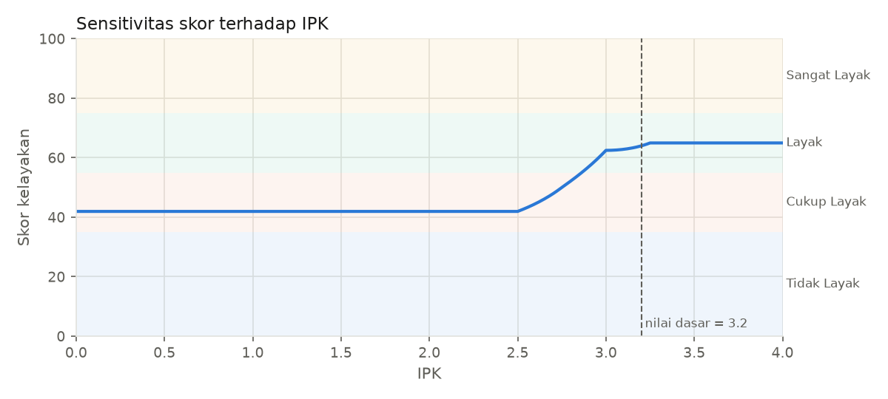

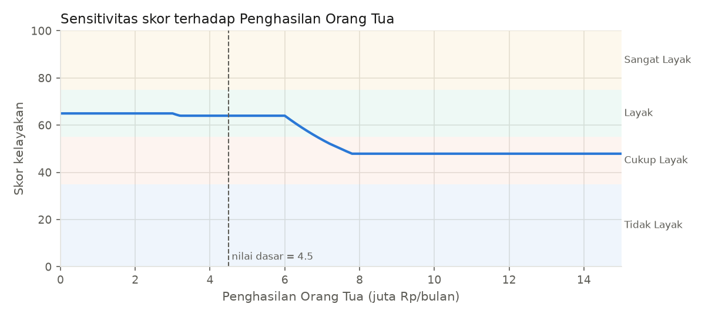

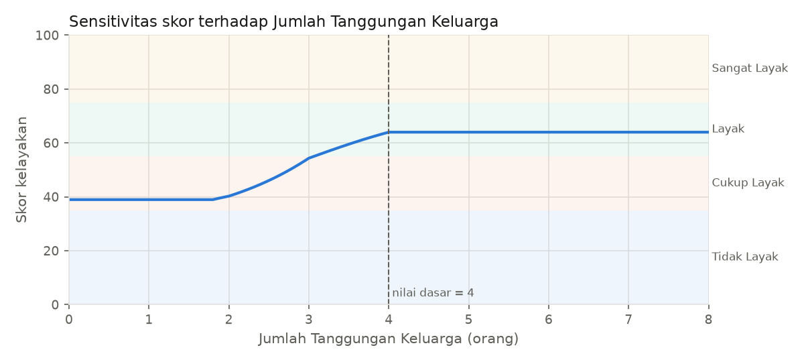

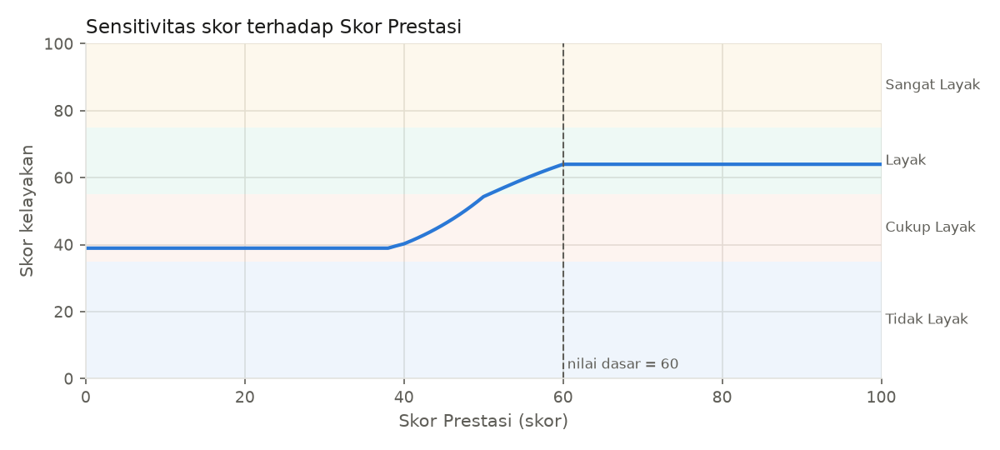

## 8. Keterbatasan dan Saran Pengembangan

1. **Subjektivitas parameter MF.** Titik seperti "penghasilan ≥ 9 juta = Tinggi" atau "IPK 3,0 = Sedang" ditentukan oleh penyusun berdasarkan kebiasaan syarat beasiswa, bukan dari data atau survei pakar. Daerah lain (misalnya dengan UMR berbeda) memerlukan parameter yang berbeda. Saran: tentukan parameter melalui diskusi dengan panitia, gunakan distribusi data pendaftar sebenarnya (misalnya persentil), atau sesuaikan per wilayah.
2. **Kualitas dan kelengkapan aturan.** Aturan 2-anteseden menjamin cakupan, tetapi tidak dapat menangkap semua interaksi 4 variabel. Karena itu kelompok A dan B berdiri setara, sehingga bobot relatif antar-kriteria muncul secara implisit dari struktur aturan, bukan dinyatakan eksplisit. Saran: validasi aturan bersama pakar, tambahkan bobot aturan, atau bandingkan dengan aturan lengkap 81 kombinasi.
3. **Data simulasi.** Ke-22 data dibuat untuk menguji perilaku sistem (ekstrem, batas, tumpang tindih, bertentangan), bukan data pendaftar nyata. Belum ada "kebenaran dasar" (keputusan panitia) yang dapat dipakai untuk mengukur akurasi. Saran: uji dengan data historis seleksi dan hitung kesesuaiannya dengan keputusan panitia.
4. **Efek resolusi grid centroid.** Centroid dihitung secara diskrit. Dengan Δz = 0.1 galatnya < 0,03 poin terhadap centroid kontinu, tetapi grid kasar (Δz ≥ 5) dapat menggeser skor 1–3 poin (Bab 7.2).
5. **Kompresi skor oleh centroid.** Skor efektif hanya 18.0–77.4, bukan 0–100, karena centroid selalu berada di dalam daerah agregasi dan tidak pernah mencapai ujung semesta. Saran: interpretasikan skor relatif terhadap kategori, atau pertimbangkan metode defuzzifikasi lain (misalnya mean of maximum) maupun penyesuaian bahu output.
6. **Plateau dan saturasi** (Bab 7.3). Pada beberapa kombinasi, perbaikan satu kriteria tidak menaikkan skor. Hal ini benar secara logika MIN/MAX, tetapi dapat terasa kurang adil. Saran: bandingkan dengan operator AND = PRODUCT atau metode Sugeno.
7. **Pengembangan lain:** tambah kriteria (status yatim/piatu, kepemilikan rumah, daya listrik), tambah fitur akun panitia dan riwayat penilaian pada aplikasi web, dan optimasi parameter MF (misalnya dengan algoritma genetika) bila data historis tersedia.

## 9. Kesimpulan

Sistem pendukung keputusan kelayakan beasiswa berbasis fuzzy Mamdani telah dibangun dengan 4 input, 1 output, dan 22 aturan. Fungsi keanggotaan terbukti tanpa celah dan basis aturan mencakup 100% kombinasi input. Hasil engine identik dengan perhitungan manual dan hanya berselisih sekitar 0,02 poin dengan scikit-fuzzy (karena perbedaan cara menghitung centroid). Respons sistem monoton dan masuk akal pada kasus ekstrem, batas, tumpang tindih, maupun kriteria bertentangan. Skor yang dihasilkan berfungsi sebagai rekomendasi untuk panitia, bukan keputusan final.

## Pembagian Kontribusi Anggota

| No | Nama | NIM | Kontribusi |
|---|---|---|---|
| 1 |  |  |  |
| 2 |  |  |  |
| 3 |  |  |  |
| 4 |  |  |  |

## Lampiran: Cara Menjalankan Program

```bash
pip install -r requirements.txt
python scripts/grafik_mf.py      # grafik MF
python scripts/uji_cakupan.py    # uji celah & cakupan aturan
python scripts/run_all.py        # pengujian 22 data
python scripts/detail_satu.py    # perhitungan lengkap 1 mahasiswa
python scripts/sensitivitas.py   # analisis sensitivitas
python scripts/validasi.py       # validasi manual vs program vs scikit-fuzzy
python scripts/buat_laporan.py   # laporan .md dan .docx
pytest                           # pengujian kode
streamlit run app.py             # aplikasi web
```
